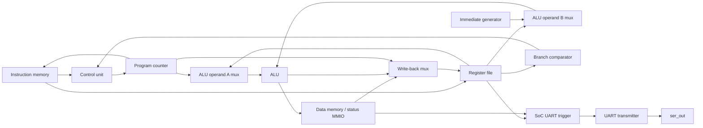

# RV32I SoC with UART Transmitter

This project is a small single-cycle RISC-V-based system-on-chip (SoC), written in SystemVerilog. It combines an RV32I integer datapath, instruction and data memories, and a UART transmitter. The RTL is organized as separate modules so the fetch/decode/execute/memory/write-back paths and the UART peripheral can be understood and simulated independently.

## Design at a glance



The processor resets to `0x80000000`. It fetches 32-bit instructions from `rtl_files/data.mem`; sequential instructions advance the PC by four bytes. The implemented instruction subset includes integer register/immediate arithmetic and logic, shifts, signed/unsigned comparisons, loads/stores, conditional branches, LUI, AUIPC, JAL, and JALR. Unsupported opcodes and unimplemented function combinations are intended to leave safe control defaults, but complete illegal-encoding validation is not implemented. This is a compact teaching core, not a complete privileged RISC-V implementation: it has no exceptions/traps, interrupts, caches, pipeline, or atomic/floating-point extensions.

### Memory and UART interface

Data memory is byte-addressed and contains 401 32-bit words. It supports `LB`, `LBU`, `LH`, `LHU`, `LW`, `SB`, `SH`, and `SW`; signed loads are sign-extended and unsigned loads are zero-extended. Addresses outside the implemented RAM range read as zero and are not written.

| Byte address | Use |
| --- | --- |
| `0x000`–`0x63F` | General data RAM (word indices 0–399) |
| `0x640` (1600) | RAM word 400 and the SoC UART transmit trigger address |
| `0x644` (1604) | Read-only UART status: `1` ready/idle, `0` busy |

On a decoded store whose effective address is `0x640`, the SoC wrapper captures the low byte of register `x6` and requests a UART transmission. The transmitter emits a frame with one low start bit, eight data-bit slots, and one high stop bit. The current RTL sends the data bits in bit-7-to-bit-0 order; this differs from conventional UART LSB-first order and is listed as future work. The baud selector defaults to the input-clock bypass (`S=00`) in the SoC wrapper for fast simulation. Other selector values choose divider outputs.

## Source files

| File | Role in the design |
| --- | --- |
| [`rtl_files/SOC_riscv_uart.sv`](./rtl_files/SOC_riscv_uart.sv) | Top-level wrapper; connects the processor, UART, and store-address transmit handshake. |
| [`rtl_files/riscv_data_path.sv`](./rtl_files/riscv_data_path.sv) | Wires together fetch, decode, execution, branch, memory, and write-back components. |
| [`rtl_files/PC.sv`](./rtl_files/PC.sv) | Holds the current instruction address and selects sequential or control-flow targets. |
| [`rtl_files/inst_mem.sv`](./rtl_files/inst_mem.sv) | Loads `data.mem`, fetches by PC, and exposes instruction fields to decode/register reads. |
| [`rtl_files/Control_unit.sv`](./rtl_files/Control_unit.sv) | Decodes opcode/function fields into PC, ALU, memory, immediate, and register controls. |
| [`rtl_files/reg_file.sv`](./rtl_files/reg_file.sv) | Implements x0–x31, two combinational reads, one clocked write, and x6 UART data output. |
| [`rtl_files/imm_gen.sv`](./rtl_files/imm_gen.sv) | Reassembles and extends I/U/S/B/J immediates. |
| [`rtl_files/A_mux.sv`](./rtl_files/A_mux.sv), [`rtl_files/B_mux.sv`](./rtl_files/B_mux.sv) | Select ALU operands from PC/register values and immediate/register values. |
| [`rtl_files/alu.sv`](./rtl_files/alu.sv) | Executes arithmetic, logic, shifts, comparisons, and address/result operations. |
| [`rtl_files/Branch_comp.sv`](./rtl_files/Branch_comp.sv) | Produces equality and signed/unsigned less-than results for conditional branches. |
| [`rtl_files/data_mem.sv`](./rtl_files/data_mem.sv) | Implements byte/halfword/word RAM access and the UART status read location. |
| [`rtl_files/mem_mux.sv`](./rtl_files/mem_mux.sv) | Selects load data, ALU result, or PC+4 for register write-back. |
| [`rtl_files/transmitter_controller.sv`](./rtl_files/transmitter_controller.sv) | Converts a loaded byte into UART start, data, and stop bits. |
| [`rtl_files/baud_rate_selector.sv`](./rtl_files/baud_rate_selector.sv), [`rtl_files/clock_divider.sv`](./rtl_files/clock_divider.sv) | Select the UART timing clock and generate divided clocks. |
| [`rtl_files/data.mem`](./rtl_files/data.mem) | Example instruction image used by the instruction memory. |
| [`tb/tb_SOC.sv`](./tb/tb_SOC.sv) | Self-checking processor/SoC integration testbench. |
| [`rtl_files/tb.sv`](./rtl_files/tb.sv) | Standalone UART transmitter frame testbench. |
| [`tools/run_sim.sh`](./tools/run_sim.sh) | Builds and runs the SoC testbench with Verilator. |

## Simulation and testbenches

Install Verilator and a C++ build toolchain on Ubuntu/Debian:

```bash
sudo apt update
sudo apt install verilator build-essential
```

From the repository root, run the SoC integration test:

```bash
./tools/run_sim.sh
```

The script places build products in `tools/obj_dir/`, runs from `rtl_files/` so `data.mem` is found, and writes `rtl_files/soc_wave.vcd`. The main testbench constructs short instruction images directly, resets the SoC between scenarios, runs each program, and checks architectural register results. Its current coverage includes:

- x0 hardwiring, register/immediate arithmetic and logic, shifts, and signed/unsigned comparisons;
- LUI/AUIPC and PC-relative result generation;
- byte/halfword/word stores and loads, including sign/zero extension;
- taken and not-taken BEQ/BNE plus taken BLT/BGE/BLTU/BGEU conditions;
- JAL/JALR target selection, skipped instructions, and PC+4 link values;
- reading the UART ready status through the memory-mapped status address;
- a deterministic varied sequence of word stores followed by CPU load-back checks;
- a global timeout so a stuck simulation fails instead of hanging indefinitely.

The standalone UART testbench can be run separately from the repository root:

```bash
verilator --binary --timing --top-module tb_transmitter_controller \
  --Mdir /tmp/uart_unit_build \
  rtl_files/baud_rate_selector.sv rtl_files/clock_divider.sv \
  rtl_files/transmitter_controller.sv rtl_files/tb.sv
/tmp/uart_unit_build/Vtb_transmitter_controller
```

It loads `0xA5`, checks the start bit, each data-bit slot in the current bit-7-to-bit-0 order, the stop bit, and return to ready. The main SoC testbench writes test instructions into the instruction-memory array hierarchically (no assembler is needed), asserts reset between test programs, then inspects architectural register results. To inspect the main SoC waveform, install GTKWave and open it with `gtkwave rtl_files/soc_wave.vcd`.

## Future work

- Add end-to-end UART assertions that decode the serial line after a CPU store, including back-to-back writes and behavior while busy.
- Change the UART controller and its unit test to conventional least-significant-bit-first transmission.
- Add test programs for every not-taken branch outcome, boundary immediates, unaligned accesses, and invalid instruction encodings.
- Add assertions or a reference-model scoreboard for PC progression, register writes, and memory transactions.
- Expand the ISA toward full RV32I details, including exception handling for misaligned/out-of-range accesses and exact legality checks for shift encodings.
- Add UART receive, interrupts, timers, GPIO, and a more explicit bus/peripheral interface.
- Parameterize clock frequency and baud rates, and verify divider timing at each selector setting.

## Author

Ahmad Mukhtar
